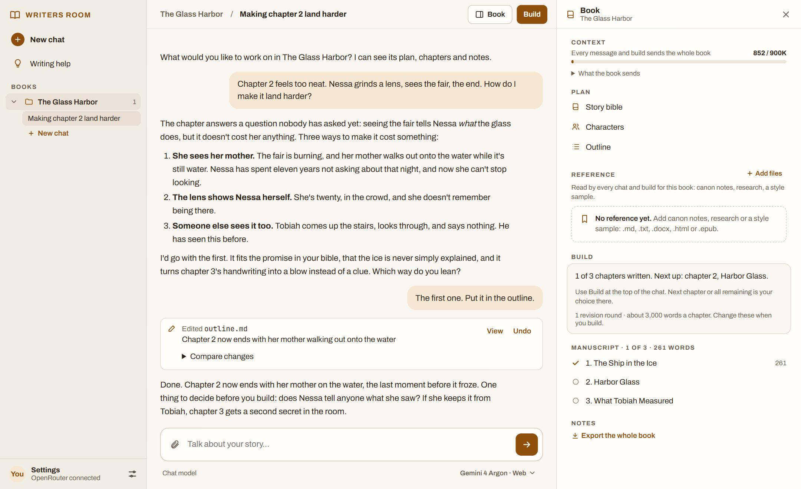
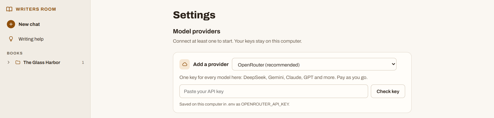
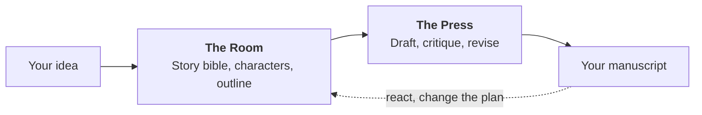
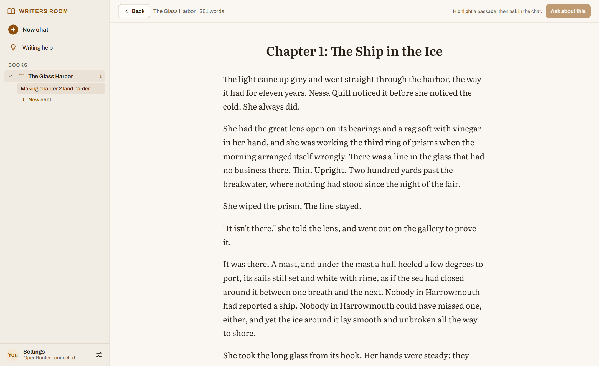
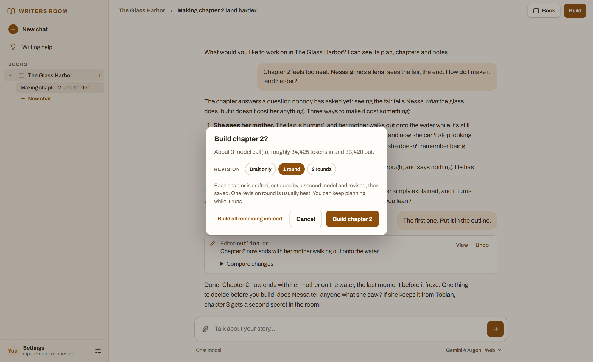

<div align="center">


<h1>AI Writers' Room</h1>

<p><strong>Plan and write a novel with AI, and keep every decision yours.</strong><br>
Fanfiction or your own world, one book or a whole series. No writing theory required.</p>

[](https://github.com/DinomyteHero/AI_Novel_Writing_Room/actions/workflows/ci.yml)
[](LICENSE)
[](https://www.python.org/downloads/)

[Quick start](#quick-start) · [How it works](#how-it-works) · [Cost and privacy](#cost-and-privacy) · [Guide](docs/guide.md)

</div>

<br>

<picture>
  <source media="(prefers-color-scheme: dark)" srcset="docs/images/chat-dark.png">
  
</picture>

<p align="center"><sub>A made-up sample book, written for this picture.</sub></p>

## What it does

You talk through your story in a chat. Bring whatever you have: a one-line idea,
a few characters, a rough outline. The chat offers options and asks questions, and
keeps your story bible, character sheets and outline up to date as decisions land.
When you're ready, the app builds chapters from your plan: one model drafts, a
different model critiques the draft, and the first revises it.

- **You stay the author.** The chat offers choices and records only what you agree
  to. Edit any file yourself and your edit wins.
- **It remembers the whole book.** Every model call reads your whole plan and every
  chapter before the one it's working on. Nothing is summarised behind your back.
- **Your book is plain files.** Everything is Markdown on your own computer, ready
  to open, copy or back up. You can always leave with your book.
- **Your work is safe.** Every change can be undone, and every replaced version of
  a chapter is kept.
- **Use the models you like.** One OpenRouter key reaches every major model; direct
  keys and a model on your own computer also work.

## Quick start

You need an API key from a model provider. [OpenRouter](https://openrouter.ai/keys)
is the easy choice: one pay-as-you-go key for every model. The app installs
everything else it needs, apart from Python itself, and tells you if that's missing.

1. **[Download the app](https://github.com/DinomyteHero/AI_Novel_Writing_Room/archive/refs/heads/main.zip)**
   and unzip it.
2. **Double-click the starter** in the unzipped folder:

   | On | Double-click |
   |---|---|
   | Windows | `Start Writers Room.bat` |
   | Mac | `Start Writers Room.command` |
   | Linux | Run `./"Start Writers Room.command"` in a terminal |

   The first start takes a minute or two to set up. After that it takes a second or
   two. Your browser opens the app at `http://127.0.0.1:8765/`. Keep the small window
   open while you write; closing it stops the app.
3. **Paste your key** on the Settings page, which opens by itself the first time.

   

4. **Type your idea** and start talking.

<details>
<summary><strong>Windows or your Mac won't open the starter?</strong></summary>

<br>

These warnings are normal for a new app from the internet. The starter is a short
text file you can read first: [Windows](Start%20Writers%20Room.bat),
[Mac and Linux](Start%20Writers%20Room.command).

- **Windows says "Windows protected your PC".** Choose **More info**, then
  **Run anyway**.
- **Your Mac says it can't be opened.** Open Terminal, type `sh ` with a space after
  it, drag the file into the window and press Return.
- **It says Python is missing.** It opens the download page. Install Python 3.10 or
  newer, then start it again.

</details>

<details>
<summary><strong>Prefer git and a terminal?</strong></summary>

<br>

```bash
git clone https://github.com/DinomyteHero/AI_Novel_Writing_Room.git
cd AI_Novel_Writing_Room
pip install -r requirements.txt
python scripts/app.py
```

</details>

## How it works

The tool has two halves, and the files are all they share.



**The Room is where you think.** Plan in conversation, or edit the files by hand. Rename
a character and it changes everywhere. Ask for a second opinion and a different model
reviews everything, then you go through its points together, keeping what you agree
with. A standalone book becomes a series the moment you ask for a sequel.

**The Press is where chapters get made,** without you sitting there. Build one chapter
at a time to find the voice, or the whole book at once. Each build leaves a report of
what it did.

<table>
  <tr>
    <td width="50%"></td>
    <td width="50%"></td>
  </tr>
  <tr>
    <td align="center"><sub>Read a chapter, highlight a passage and ask about it.</sub></td>
    <td align="center"><sub>See the estimate before a build spends anything.</sub></td>
  </tr>
</table>

## Cost and privacy

**Cost.** The app is free. You pay your model provider for what you use, and because
every call sends the whole book, costs grow as the book grows. The Build card shows an
estimate before anything is spent, a small line under each chat reply shows what that
turn used, and each build's report shows what it really used.

**Privacy.** There's no account, no hosted service and no analytics. The app runs on
your computer and listens only to your computer. Your books and keys stay in ordinary
files there, and git ignores them. Three things do go over the network:

- **Your book goes to the model provider you connect,** on every call, under that
  provider's own terms. Run a model on your own computer (Ollama or llama.cpp) to
  keep the writing at home.
- **The app fetches OpenRouter's public model list** at most once a day when OpenRouter
  is connected. Nothing of yours is sent with it.
- **The page loads its typefaces from Google Fonts.**

## Models

Each chat picks its own model and reasoning effort under the message box. Connect a
provider and the jobs below move to its models by themselves, or choose them by hand
in Settings. These are the defaults, all through OpenRouter, each with a roughly
1M-token context window:

| Job | Default model |
|---|---|
| Planning chat (with web search), drafting and revising | Gemini 4 Argon |
| Critiques, reviews and ideas | Claude Sonnet 5.5 |
| Story-so-far notes for later books | DeepSeek V4.1 Flash 1017 |

OpenRouter, Anthropic, OpenAI, Google, DeepSeek, Qwen and local models are all
supported. With OpenRouter, the model lists keep up with new releases and show prices.

## Other ways to use it

The app, the plugin and the command line all work on the same files, so you can
switch between them.

<details>
<summary><strong>The Claude plugin (Cowork and Claude Code)</strong></summary>

<br>

Claude itself becomes the Room: it plans with you and edits the files, and the
plugin's tools add second opinions, renames and the Press. It needs Python 3.10+ on
your computer and installs what else it needs on first run.

**In Cowork:** go to **Customize > Plugins > Add > Add marketplace**, choose **Add from
a repository**, enter `DinomyteHero/AI_Novel_Writing_Room`, then install **Writers
Room** and add your OpenRouter key in its settings.

**In Claude Code:**

```bash
claude plugin marketplace add DinomyteHero/AI_Novel_Writing_Room
claude plugin install writers-room@writers-room
```

Then say what you're writing, or use `/writers-room:start`, `/writers-room:ideas`,
`/writers-room:review` and `/writers-room:build`.

</details>

<details>
<summary><strong>The command line</strong></summary>

<br>

```bash
cp .env.example .env                    # then paste your OPENROUTER_API_KEY into .env
python scripts/room.py check            # confirms the key works
python scripts/room.py new "My Novel"   # or add --series "My Series"
python scripts/room.py review           # optional second opinion
python scripts/press.py build next      # one chapter, then read it
python scripts/press.py build all       # the rest, unattended
python scripts/room.py status
python scripts/press.py export
```

</details>

## Learn more

| | |
|---|---|
| [The guide](docs/guide.md) | Everything the app can do, and how to back up and update |
| [The craft guide](prompts/studio/craft_guide.md) | The friendly lenses (not rules) the chat and every model share. Your story bible always wins over it |
| [Contributing](CONTRIBUTING.md) | How to set up, test and propose a change |
| [Design notes](docs/design/writing-workspace.md) | The thinking behind the product |
| [Security](SECURITY.md) | How to report a vulnerability |

## License

[Apache 2.0](LICENSE). The license covers the software, not any franchise you write
about; see the [disclaimer](DISCLAIMER.md) for notes on fanfiction and third-party
material.
